# HearSay Studio manual

HearSay Studio is the desktop app of HearSay. Give it a recorded note, and it searches for a six-operator FM patch
that sounds like it, which you can play on the screen keyboard or a MIDI controller, change in a block diagram, and
take to SuperCollider. It also opens the structure library of every synthesis target as a map of sound families to
browse, filter and play.

This manual is about using the Studio. The [expert manual](expert-manual.md) explains what happens underneath: how to
prepare targets, what the synthesis targets FM7, FMX6 and Nome6 can do, what the loss numbers mean, the command line,
the library API and how to play the exported code in SuperCollider. Where a topic is covered there, this manual links
to it.

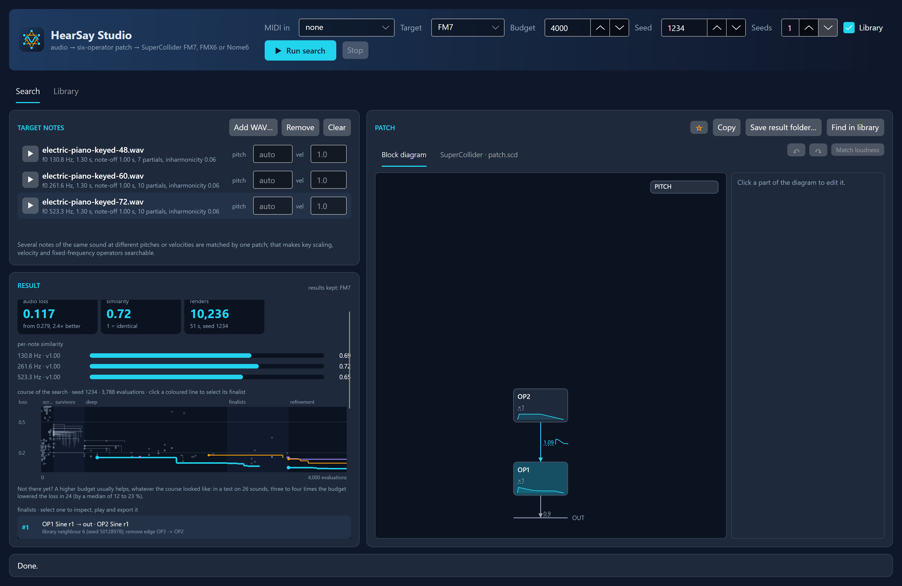

*HearSay Studio after a search: the target notes on the left, the result under them, the patch on the right.*

Contents

1. [Installing and starting](#1-installing-and-starting)
2. [The window](#2-the-window)
3. [Matching a sound](#3-matching-a-sound)
4. [Reading the result](#4-reading-the-result)
5. [Playing like a synth](#5-playing-like-a-synth)
6. [The block diagram](#6-the-block-diagram)
7. [Editing a sound](#7-editing-a-sound)
8. [Formant filters and vowels](#8-formant-filters-and-vowels)
9. [Starting from scratch](#9-starting-from-scratch)
10. [Keeping sounds](#10-keeping-sounds)
11. [The Library tab](#11-the-library-tab)
12. [Files and settings](#12-files-and-settings)
13. [Troubleshooting](#13-troubleshooting)

## 1. Installing and starting

The release builds of HearSay Studio are self-contained: unpack and start, nothing else to install. This manual and
the expert manual come with them as PDF files, `HearSay-Studio-Manual.pdf` and `HearSay-Expert-Manual.pdf`, and so
do the design of the search, `HearSay-Patch-Matching.pdf`, and the library reference, `HearSay-Library-Reference.pdf`.

- **Windows:** unzip and start `HearSay.Studio.exe`. SmartScreen may warn about an unknown publisher: *More info*,
  *Run anyway*.
- **macOS:** unzip; the folder `HearSay Studio` holds the app and the manuals. Move `HearSay Studio.app` to
  Applications. The app is not notarized: the first time, right-click
  it and choose *Open*, or run `xattr -dr com.apple.quarantine "/Applications/HearSay Studio.app"`. `osx-arm64` is
  for Apple Silicon, `osx-x64` for Intel Macs.
- **Linux:** unpack and start `./HearSay.Studio`. Sound needs a working OpenAL output (PulseAudio or PipeWire).

The Studio plays through OpenAL Soft. Without an audio device the keyboard is silent and a note under it says so;
everything else works. To play the exported patches you need SuperCollider with the plugin of the synthesis target:
sc3-plugins for FM7, the FMX6 plugin for FMX6, the Nome6 plugin for Nome6 (expert manual,
[section 8](expert-manual.md#8-playing-the-export-in-supercollider)).

> [!WARNING]
> **The first use of each synthesis target keeps your CPU busy for a while.** The first search with FM7, FMX6 or Nome6
> (or the first look at its Library tab) builds that target's structure library: it renders 300 000 to 600 000 sounds
> once, on every core at full speed, so fans spin up and the machine gets warm. That is expected, not malware. It takes
> under a minute for FM7, about 11 minutes for Nome6 and 20 for FMX6 on a 24-thread desktop (longer with fewer
> cores), shows its progress and the time left, and stores 86 to 175 MB in the local application data. After that the
> library is reused, and starting the Studio itself never builds anything. **The Studio asks before it starts a build**,
> with the estimate for your computer: build it now, search without it, or not now.

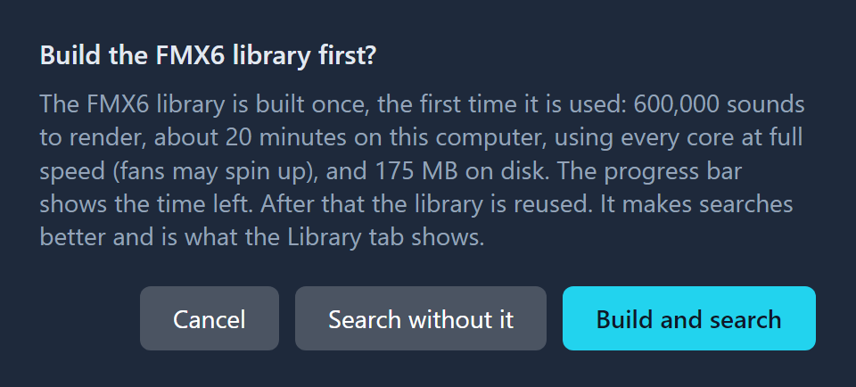

*Asked before a search that would build a library: what it costs on this computer, and what you can do instead.*

- **Before a search** that would build a library, the Studio asks: **Build and search** (the default) builds it and
  searches with it; **Search without it** searches without that library, now and for the rest of the session (the
  status line says so after each search); **Cancel** starts nothing. With *All* targets it asks once for every library
  still missing. With the *Library* check box off it never asks.
- **Before the Library tab** shows a library that is not built, it asks: **Build now**, or **Not now**, which leaves
  the tab empty with a **Build the library now** button for later.
- Once you said yes, neither tab asks again for that library while the Studio runs.

The library makes searches better and is what the Library tab shows. While it is built, the status line and the
progress bar show the share done and the time left (section 11 for the Library tab).

## 2. The window

The header holds what a search needs and the MIDI input:

| Control | What it does |
| --- | --- |
| **MIDI in** | The MIDI input device that plays the sound of the visible tab (section 5). |
| **Target** | The synthesis target to search for: FM7, FMX6, Nome6, or All (all three, one after the other). |
| **Budget** | How many candidate sounds the search may render (expert manual, [section 5](expert-manual.md#5-budget-seeds-and-time)). |
| **Seed** | Which search to run: the same seed on the same notes gives the same result. |
| **Seeds** | How many seeds to run, each with the full budget; the best result wins. |
| **Library** | Start the search from the nearest sounds of the structure library as well (on by default). |
| **Run search**, **Stop** | Start the search; stop it and keep the best patch found so far. |

Under the header are two tabs. **Search** matches target notes and shows the result; **Library** shows the structure
library and your favourites. Both have a patch card with the block diagram (open by default) and the SuperCollider code
of the sound they show, and a keyboard to play it. The line at the bottom of the window is the status line: what the Studio is
doing, and why an edit or an action was refused.

## 3. Matching a sound

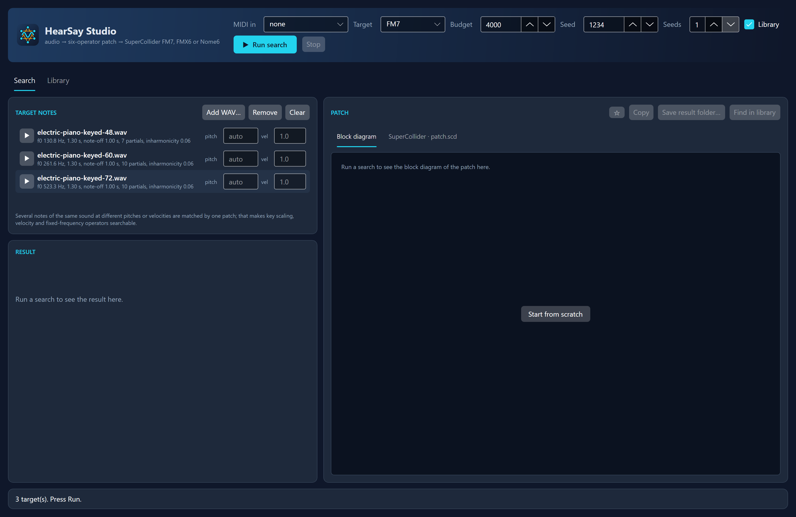

*Three notes of the same electric piano, at MIDI notes 48, 60 and 72, ready to be matched by one patch.*

1. **Add WAV…** adds one or more recorded notes. Each is analysed at once and shows its fundamental, its length, the
   note-off, the number of partials and the inharmonicity. The play button beside it plays the file as it is.
2. When you know the pitch or the velocity of a note, type it: *pitch* takes a MIDI note or a frequency in Hz, *vel*
   a velocity from 0 to 1. A wrong fundamental makes every frequency ratio wrong, so give it when the analysis is
   an octave off (expert manual, [section 2](expert-manual.md#2-preparing-a-target)).
3. Several notes of the same sound make a *target set*: one patch is matched to all of them, which makes key scaling,
   velocity sensitivity and fixed-frequency operators searchable (expert manual,
   [section 3](expert-manual.md#3-target-sets-several-notes-one-patch)). **Remove** removes the selected note, **Clear**
   all of them.
4. Choose the **Target**: FM7 for six sine operators (the classic DX sound), FMX6 for other waveforms, noise and
   filters, Nome6 for elliptic waveforms and shared noise (expert manual,
   [section 4](expert-manual.md#4-choosing-the-synthesis-target)).
5. Set the **Budget** and the **Seeds**. 4000 is quick and often enough to find the structure; 20000 is a thorough
   search. Two seeds at a budget usually beat one seed at twice the budget.
6. **Run search.** The progress bar shows the run within the seeds and the stage within the run, and the Result card
   draws the course of the search as it goes (section 4). **Stop** ends the search early with the best patch found so
   far.

**Every target keeps its last result** for the current target notes. Search under FM7, switch the Target selector to
FMX6, search again, and switch back and forth to compare the two by ear on the keyboard, in the block diagram and in
the code. **All** runs the three searches one after the other, with the full budget and seeds each, keeps every
result and shows the one with the lowest loss; the status line has all losses and similarities, and choosing a single
target shows that one. The result header says which results are kept; adding a target note discards them all.

A search is reproducible: a target whose kept result was searched with the same inputs (the same files, unchanged on
disk, with the same pitch and velocity, budget, seed, number of seeds and library setting) is not searched again.
After a Nome6 search, All searches only FM7 and FMX6, and the status line says how many results were kept. A search
that was stopped early is always searched again.

## 4. Reading the result

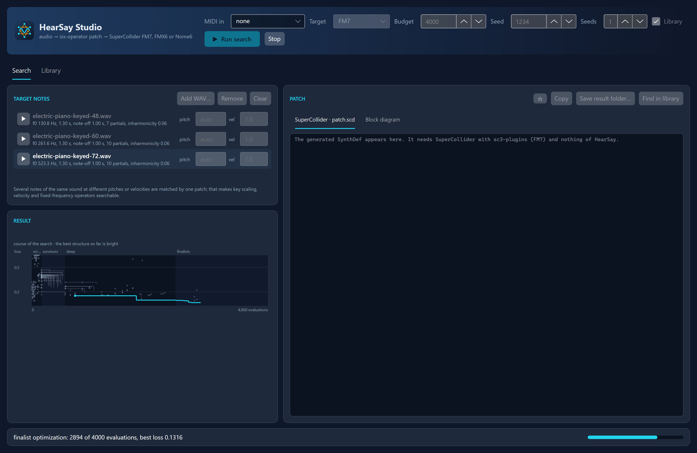

*A search halfway: every structure the search follows is a line that falls as its loss improves; the best so far is
bright.*

The **Result** card shows the selected finalist:

- **Three tiles**: its *audio loss* (0 is identical; with the loss the search started from, and how much better it got),
  its *similarity* (1 is identical), and the search's renders and time, with the seed. The expert manual explains the
  numbers in [section 6](expert-manual.md#6-reading-a-result) and
  [section 13](expert-manual.md#13-the-objective-and-the-loss-numbers).
- **Per-note similarity**: a bar per target note.
- **Course of the search**: the loss (on a logarithmic scale) against the evaluations used, drawn while the search
  runs and kept with the result. Bands mark the stages: *screening* tries many structures briefly (each a grey dot),
  *survivors* and *deep* optimize the most promising ones and their mutations, *finalists* the best few, and
  *refinement* polishes them more precisely. Every structure is a line that steps down where its loss improved; a
  line breaks where the stage judges the loss differently (screening roughly, refinement in more detail). While the
  search runs, the best line so far is bright; afterwards the finalists have the colours of their place in the list,
  the selected one thickest, and a click on a line selects its finalist (the pointer on it names it). Under the chart a
  note says what a higher budget brings: in a test on 26 sounds, three to four times the budget lowered the loss in 24,
  whether the loss was still falling at the end or had stood still (expert manual,
  [section 5](expert-manual.md#5-budget-seeds-and-time)).
- **Finalists**: the best patches of the search, with their rank, the operators in use and where they came from. Select
  one to inspect it: the tiles, the bars, the patch card and the keyboard follow the selection. The search compares
  only the best patch with the targets; another finalist is compared the first time it is selected (its similarity
  reads … for a moment) and kept.
- **Keyboard**, **matrix** and **routing**: the keyboard plays the finalist (section 5); amber dots mark the target
  notes. The matrix has a row per destination and a column per source, in radians, the diagonal being
  self-feedback.

The **Patch** card opens on the **Block diagram** of the shown finalist (section 6). Its second tab, **SuperCollider ·
patch.scd**, has the code, at the level the Studio plays it at; the header of the code says whether it is the best
patch or an alternative.

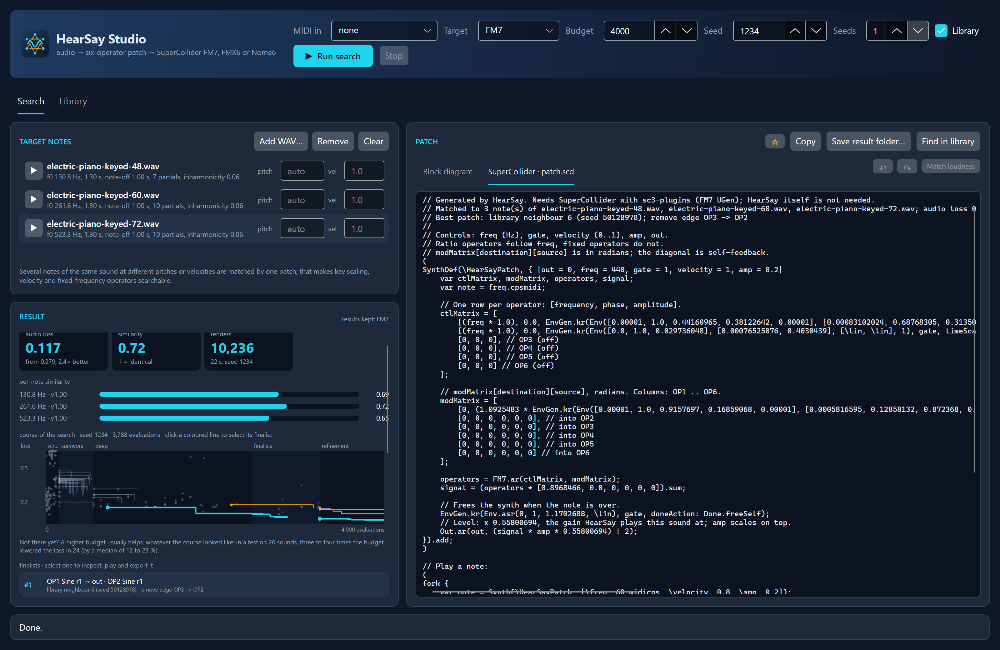

*The second tab of the patch card: the SuperCollider code of the shown finalist, ready to copy or save.*

- **Copy** puts the code on the clipboard.
- **Save result folder…** writes the whole result: `patch.json`, `patch.scd`, `preview.wav`, the alternatives and a
  `search-summary.json` (expert manual, [section 7](expert-manual.md#7-the-result-folder)).
- **Find in library** opens the Library tab on the library of the result's synthesis target and places the shown
  finalist among the library sounds like it (section 11). It joins the *Imported* list there as *search best* or
  *search #2*, so several finalists can be compared in the library.
- **☆** keeps the shown sound as a favourite (section 10).

## 5. Playing like a synth

The keyboard of each tab, and a MIDI controller, play the sound of the visible tab: in the Search tab the shown
finalist (or the library sound shown there), in the Library tab the last sound clicked.

- A note sounds for as long as its key is held: an envelope with a sustain point holds there until the key is let go
  and then plays its release; a percussive envelope runs its course whatever the key does. What you hear is what the
  search matched and what the SuperCollider code plays for a note held that long.
- The keyboard spans MIDI notes 0 to 127; it opens centred on C4 for every new result. Pressing lower on a key plays
  louder (velocity 0.3 to 1.0). A patch without velocity sensitivity follows the velocity as volume instead, and the
  caption says so. Sliding a held pointer onto another key releases the old note and plays the new one; every finger
  on a touch screen holds a note of its own. The scroll bar under the keys scrolls the keyboard.
- Up to 16 notes sound at once; a 17th takes the oldest, which fades out over a few milliseconds. A note keeps the
  sound it started with: select another finalist or click another sound while holding a chord, and the new notes play
  the new sound while the held ones go on. Keys light up while they sound, from the mouse or from MIDI.
- **MIDI in** chooses the MIDI input device: *none*, then the devices by name. The list is read again whenever it
  opens. Note-on, note-off and velocity are used, on every channel; pitch bend, controllers, the sustain pedal,
  aftertouch and program changes are ignored. The choice is remembered between sessions; a remembered device that is
  not connected at the start leaves the selector on *none*. A device unplugged while open releases its notes and the
  selector goes back to *none*.
- An audio device unplugged while the Studio runs (headphones, a USB interface) is noticed within a second: live
  notes stop, the keyboard says it is silent, and the status line asks to restart the Studio once an audio device is
  connected again.
- From key to sound takes about 41 ms on Windows. A running search or library build keeps its full speed, so notes
  may stutter while one runs; on an otherwise idle machine they play cleanly.

## 6. The block diagram

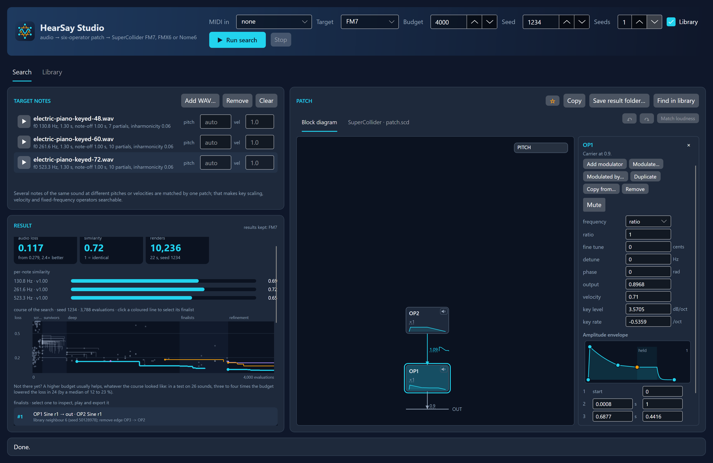

*The block diagram tab: OP1 is selected, and the inspector beside the diagram shows its values.*

The **Block diagram** tab, the first of the patch card and open by default, draws the operators in use:

- **Carriers** on the bottom row, feeding OUT with their output levels; every modulator above what it modulates.
- **Connections** with their amounts in radians: dashed amber when they feed back, a loop for self-feedback, and a
  small sketch beside the amount when it follows an envelope. Resting the pointer on an amount shows the connection
  with its envelope.
- **Each operator box** gives the frequency (a ratio such as *×2*, or a fixed frequency) and a short waveform name
  (*tri*, *sqr*, *pls0.3* with its duty cycle, *S&H*, *fnoise*, *ell q0.26* with the nome), and a sketch of its
  amplitude envelope. Time runs on a square-root scale, so that a 5 ms attack and a 2 s decay both show, with a flat
  stretch where the note is held. An operator filter is a strip at the bottom of the box; a filter sweep is a violet
  line over the envelope. Resting the pointer on a box shows everything about the operator.
- **NOISE** (Nome6) at the top left: the shared noise source with its colour (*white*, or for example *LP 60% · 1.9
  kHz*), with a dotted line into every operator that plays it (*plays*) or that it roughens (*φ 0.4*, *m -0.2*). When
  nothing that is heard uses the noise, the box is greyed and reads *unused*: its colour and cutoff then change nothing.
- **PITCH** at the top right: the vibrato (*vib 5.5 Hz ±14 ct*) and the pitch envelope, in cents around the note. It
  moves the ratio operators only; fixed-frequency ones keep their pitch.
- An operator that is in use but cannot be heard (output 0, and modulating nothing that is heard) is greyed.

## 7. Editing a sound

Whatever a patch card shows (a finalist, a library sound, a favourite, an imported sound) can be edited in its block
diagram, in both tabs. The original is never changed: editing works on a copy, and the next note played plays the
edit (notes already held keep their sound). The diagram follows every edit at once, the code a moment later, with the
line *Edited in HearSay Studio.* in its header.

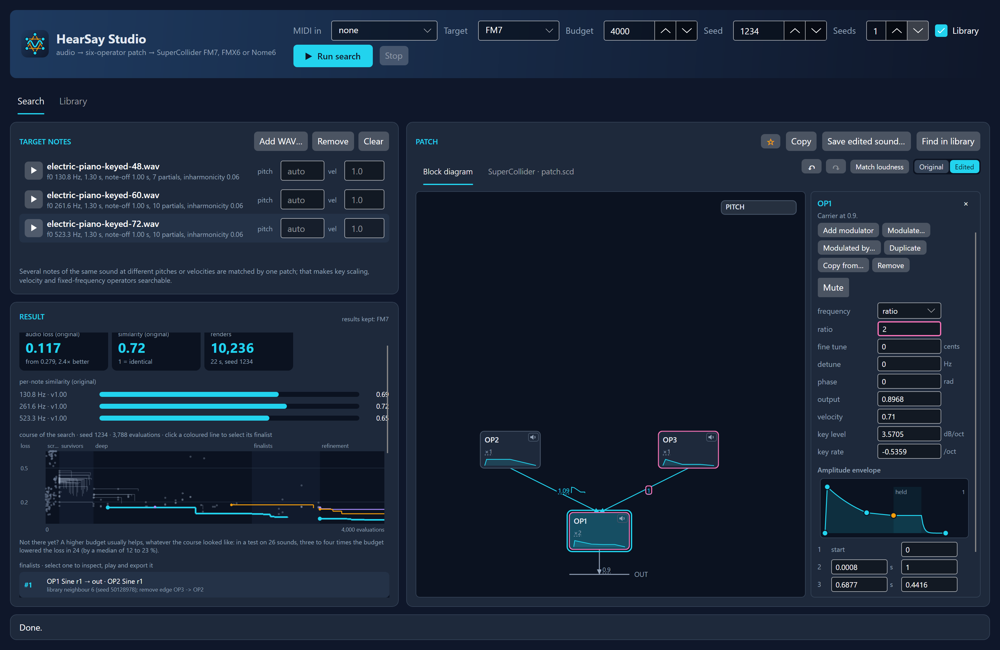

*An edit: OP1's ratio was doubled and OP3 added as a new modulator. What differs from the original is outlined in
pink; Original and Edited switch between the two.*

### Selecting

Click an operator box, the amount of a connection, the NOISE box or the PITCH box to select it: it is outlined in
cyan, and the **inspector** beside the diagram shows all its values. Clicking empty space, or the × of the inspector,
closes it. While a sound is shown the PITCH box is always there (empty when the pitch does not move), and so is the
NOISE box on Nome6, so that a pitch envelope, vibrato or noise can be added.

### Muting operators

Every operator box has a small speaker in its top-right corner. Click it to listen without that operator: its output
and its modulation of other operators fall silent, and the box, its connections and its output line turn pale; the
speaker turns amber with a cross. Click it again to hear the operator again. The inspector of an operator has the same
switch, **Mute**. Muting only changes what you hear: the patch, its code, Copy, Save, ☆ and Undo are not affected, and
nothing is marked as edited. It works on the Original side too, and muted operators stay muted across edits and the
Original ⇄ Edited switch, so you can compare both without them; another sound starts with nothing muted. The sound
keeps its loudness when you mute, so the remaining operators do not get louder.

### The inspector

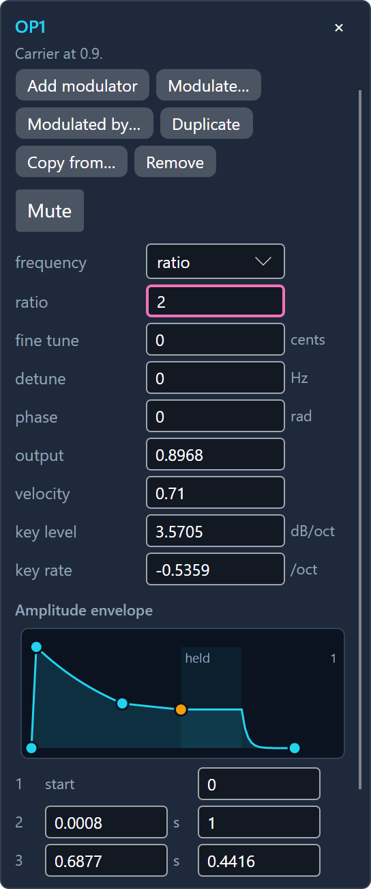

*The inspector of OP1: the buttons that change the structure, its numbers, and its amplitude envelope.*

- **An operator** has *Add modulator*, *Modulate…*, *Modulated by…*, *Duplicate*, *Copy from…* and *Remove*, menus
  for the waveform and the frequency mode (ratio or fixed Hz), its numbers, a filter section (type and *Sweep*) and,
  on Nome6, *Roughness from the shared noise*.
  - *Add modulator* takes the first free operator: a sine at ratio 1 with a short decaying envelope, modulating the
    selected operator by 1 rad and not heard on its own.
  - *Modulate…* lets the selected operator modulate another one, or itself (feedback); *Modulated by…* lets another
    one modulate it. Their menus read *OP1 → OP2*, grey the connections that exist already and mark *(not heard)* a
    connection into an operator that is not heard. A new connection starts at 1 rad and is selected, so that its
    amount can be typed or dragged at once.
  - *Duplicate* puts a copy of the operator in the first free operator, with its output level and all its
    connections: what modulates the original modulates the copy, the copy modulates what the original modulates, and
    the original's feedback becomes the copy's own. The sound changes until you change the copy (detune it, give it
    another ratio). The copy is selected; one undo removes it.
  - *Copy from…* gives the operator the settings of another one in use, chosen from a menu that names each with its
    waveform, frequency and filter: waveform, frequency, tuning, envelope, filter, velocity and key scaling,
    roughness. Its output level and its connections stay, so its place in the routing does not change. One undo
    brings the operator back.
  - *Remove* switches the operator off with its connections; the last operator that is heard cannot be removed.
- **A connection** has *Disconnect*, its amount and *Amount follows an envelope*.
- **NOISE** has its colour and cutoff, and says which operators use the noise (*Used by OP2 (plays it), OP1 (roughness
  φ 0.3).*). When none does, it says so and greys colour and cutoff: give an operator the waveform *noise*, or switch
  on its *Roughness from the shared noise*, to hear them. **PITCH** has the toggles *Pitch envelope* and *Vibrato*, and the vibrato rate,
  depth, delay and fade-in.
- **Harmonics.** A triangle, saw, square or pulse operator (FMX6) has a *harmonics* row: the number of harmonics its
  waveform is built from, 1 to 128. Few harmonics make a mellow waveform but leave nothing for a filter to shape
  higher up.

### Numbers

Type a number and press Enter (or leave the box). Or drag sideways, on the box or on its name in the inspector, or on
the dashed-underlined numbers of the diagram itself (frequency ratios, fixed frequencies, connection amounts, output
levels), even while a note plays: 200 pixels cross the whole range, along its scale (a ratio in equal musical
steps).

- Hold **Shift** for steps ten times finer.
- Hold **Ctrl** to snap a ratio to the musical ratios the search uses (0.5, 0.75, 1, 1.25, 1.5, 2, 2.5, 3, 3.5, 4 and
  on up to 16).
- **Escape** during a drag puts the value back.

### Envelopes

Envelopes are small graphs in the inspector, on the same square-root time scale as the diagram, with their
breakpoints as numbers under them. Drag a point to move it in time and level (the first point only up and down);
double-click a line to add a point; right-click a point to remove it, to hold the note there (*Sustain here*), to let
the envelope run its course (*One-shot*), or to choose the curve of the segment that ends there (linear, exponential,
step).

### Undo, Redo, Original and Edited

- **Undo** and **Redo** (the arrows right of the tabs of the patch card, or above them where the card is narrow;
  Ctrl+Z, and Ctrl+Y or Ctrl+Shift+Z) go back step by step to
  the sound as it was. One step is one drag from press to release, one typed number, one menu choice, one part added
  or removed, one envelope point, one vowel preset.
- **Original ⇄ Edited.** Once a sound is edited, this switch shows the original or the edit: the diagram, the code and
  the keyboard follow, to compare by ear. The original can be inspected but not changed. Copy, Save…, Show in Search,
  Find in library and ☆ act on the version shown; while the edit is shown, *Save result folder…* becomes *Save edited
  sound…*. In the Search tab the loss and similarity shown with an edit are the original's, marked *(original)*.
- **What the edit changed** is outlined in pink while the edit is shown. In the diagram: an operator, PITCH or NOISE
  box when anything of it changed, and a connection amount or an output level that changed. In the inspector: every
  box, menu, toggle and envelope graph whose value differs, with the original value in its tooltip (*Edited; the
  original is 1*). Everything of an operator or connection the edit added is marked (*New: not in the original*). A
  value set back by hand is no longer marked.

### Loudness

An edit plays at the loudness of the original: its gain is not normalised again after each edit, so turning an output
level down really makes it softer. An edit that changes the sound a lot can therefore be much quieter or louder than
the original, and an output level cannot go above 1.5 to make up for it. **Match loudness** computes the gain the
edit would get as a new sound and plays the edit at that gain from then on; click it again after later edits. ☆ keeps
the matched gain in the favourite. (The `preview.wav` of *Save edited sound…* is normalised on its own, to a peak of
0.7, which is why it can sound louder than an edit whose loudness was not matched.)

### Limits

An edit always stays playable by the sound's synthesis target. Values are kept within their ranges; the connections
into one operator may add up to 24 rad at most. Menus offer only what the target has: no waveform menu on FM7 (sine
only), filters on FMX6 only, roughness and NOISE on Nome6 only, and no seventh operator. An edit that cannot be made
is refused, and the status line says why.

### History

Every sound keeps its edit and its undo history while the Studio runs: look at another finalist or library sound and
come back, and the edit is still there. The same sound in both tabs shares one edit. Nothing is kept when the Studio
closes: keep an edit with ☆ or *Save edited sound…* (section 10).

## 8. Formant filters and vowels

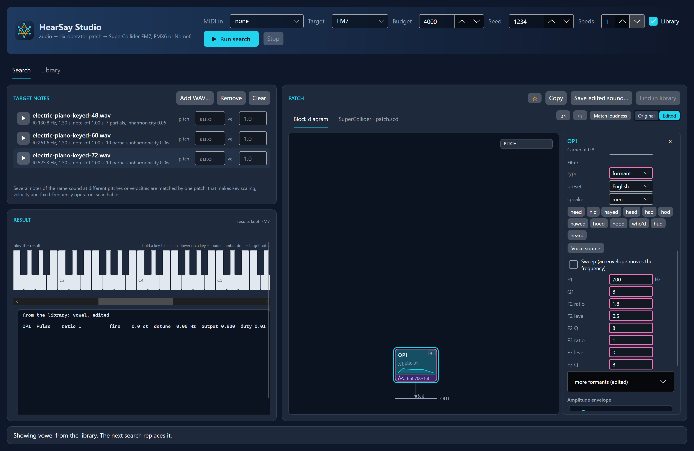

*An FMX6 operator with a formant filter, set to the vowel of "hod" by the English preset.*

An FMX6 operator can have a **formant** filter: five resonances that shape a vowel. The inspector shows F1 (in Hz)
and Q1, then F2 and F3 (ratio to F1, level and Q each), and folds F4 and F5 under *more formants*.

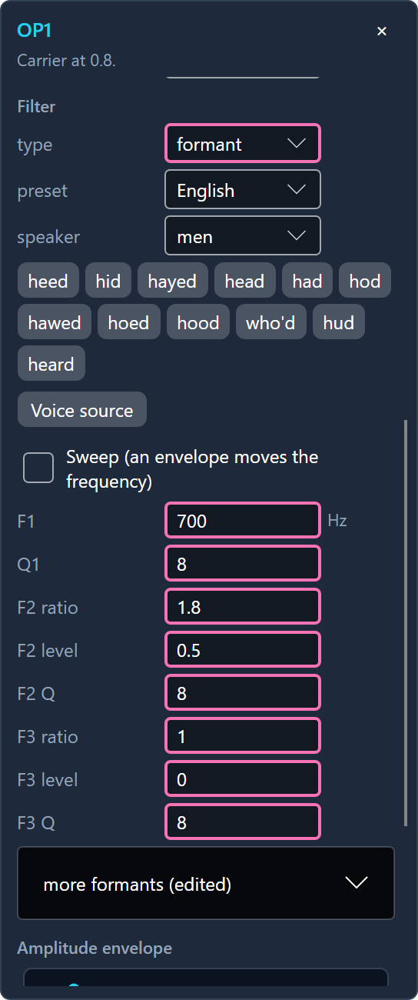

*The formant filter in the inspector: preset set, speaker, a button per vowel, and Voice source.*

- **Presets.** *preset* chooses a set of vowels, *speaker* a voice or group of speakers, and a button per vowel,
  labelled with its word (its IPA symbol in the tooltip), sets all five formants to that vowel in one step.
  - *Sung*: soprano, alto, countertenor, tenor and bass singing a, e, i, o, u (the formant table of the Csound
    manual).
  - *English*: men, women and children speaking twelve American English vowels, *heed* to *heard* (Hillenbrand et
    al. 1995).
  - *Dutch*: men and women speaking twelve Dutch vowels, *poet* to *pit* (Pols et al. 1973).
- **A vowel needs a source.** A formant filter only shapes the harmonics it is given: a vowel is heard when the
  operator sends many harmonics of about the same strength. A sine has nothing to shape. Choosing *formant* as the
  filter type, or a vowel preset on another filter, makes the operator a **voice source** in the same step: a pulse
  1 % wide with 64 harmonics. A noise operator stays noise: a whispered vowel. *Voice source* under the vowel buttons
  does the same by hand.
- The search sets F1 to F3 itself; F4 and F5 come from the presets or from typing them. The expert manual has the
  details and the sources of the presets ([section 4](expert-manual.md#operator-filters-fmx6)).

## 9. Starting from scratch

While a tab shows no sound (the Search tab before a search, the Library tab before a sound is clicked), its empty
block diagram has a **Start from scratch** button. It shows *New sound*: OP1 a sine at ratio 1 with a plain envelope,
the other operators off, on the synthesis target of the Target selector (Search tab) or of the library shown (Library
tab). From there it is edited like any other sound: add modulators, filters and the rest, play it, copy or save its
code, and keep it with ☆. In the Search tab the next search replaces it. Its edits are kept like those of any other
sound: starting from scratch again on the same synthesis target, while the Studio runs, brings them back.

*Asked before a new sound that is not kept is replaced.*

The button only shows in an empty tab, so a new sound that was edited and not kept is asked about before anything
replaces it (a search, Add WAV, another target, Show in Search, a click on another sound in the Library tab): **Replace**
goes on, **Cancel** leaves everything as it was, and ☆ then keeps it.

## 10. Keeping sounds

- **☆ Favourites.** ☆ keeps the shown sound under a nickname you type; a favourite shows a filled ★. Favourites are
  kept between sessions and listed under *Favourites* in the Library tab (section 11). Clicking the filled ★ again
  renames the favourite or removes it. ☆ on an edit keeps it as a new
  favourite whose origin reads *edited from* the original; ☆ on an edit of a favourite also offers *Update "name"*,
  which overwrites that favourite with the edit.
- **Save…** writes the shown sound as a folder that HearSay can import again: `patch.json`, `patch.scd` and
  `preview.wav` (the Search tab saves the whole result folder, or the edited sound alone while an edit is shown).
- **Copy** puts the SuperCollider code on the clipboard. The code carries the level the Studio plays the sound at, so
  it is as loud in SuperCollider as here (expert manual,
  [section 8](expert-manual.md#8-playing-the-export-in-supercollider)).

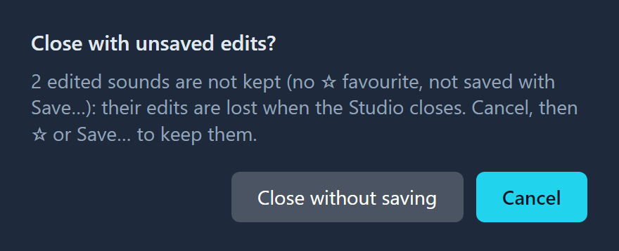

*Asked when the window is closed while edits would be lost.*

**Closing with unsaved edits.** Edits live only while the Studio runs. When the window is closed while an edited
sound, in either tab, is neither a favourite nor saved with *Save edited sound…* since its last change, the Studio
asks first, saying how many sounds that is. *Cancel* (also Enter and Escape) keeps it open; *Close without saving*
closes it.

## 11. The Library tab

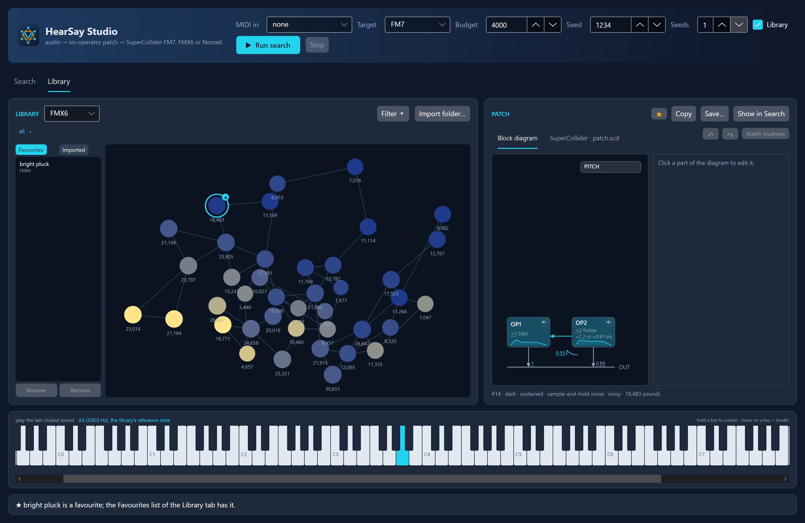

*The FMX6 structure library: each node is a family of similar sounds, sized by its number of sounds; the clicked
sound plays and shows in the patch card.*

The Library tab shows the structure library of FM7, FMX6 or Nome6 as sound families: the 300 000 sounds (600 000 for
FMX6 and Nome6) are grouped into 40 families by how they sound, each family into 40 more, down to single sounds. Every
node is a real sound, the member closest to the centre of its family. Nodes are sized by the number of sounds and
coloured from dark (blue) to bright (yellow); each is joined to its two nearest neighbours.

- **Click** a node to hear it at A3 and see its code and block diagram; the keyboard and the MIDI device then play it
  at any pitch. **Double-click** a family, or click its plus, to open it; the breadcrumb goes back up. Resting the
  pointer on a node describes it: brightness, envelope, waveform, *filtered*, *noisy*, and the number of sounds.
- **Copy** copies the SuperCollider code; **Save…** writes the sound as a folder that can be imported again; **Show in
  Search** makes it the sound of the Search tab, until the next search.
- **Import folder…** reads every `patch.json` under a folder of exported results. Click one in the *Imported* list to
  place it: the tab opens the family whose centre is closest at every level and shows the sound as a star among the
  sounds like it. Placement is by sound, so an FM7 result can be placed in the FMX6 library.
- **Favourites**, beside the graph and shown by default, lists your favourites with their synthesis targets: click one
  to place it among its neighbours in the library of its target, selected and played. **Rename** and **Remove** act
  on the selected one (removing deletes its folder, after asking).
- **Filter ▾** shows only some sounds: by the waveforms and filter types of the operators you can hear, brightness,
  envelope, noise, the number of audible operators and feedback. Values in a row are alternatives, rows must all hold
  (*saw or square*, and *low-pass*). Each choice shows how many sounds would match. **Clear** returns to all sounds.

The first time a library is opened its families are grouped (under a minute) and kept next to the library. A library
that is not on disk yet is built first, after asking (section 1), and the graph shows the share done and the time left.
Put off with *Not now*, the tab says what building it costs and offers a **Build the library now** button.

## 12. Files and settings

The Studio keeps its files in the local application data folder: `%LOCALAPPDATA%\HearSay` on Windows,
`~/Library/Application Support/HearSay` on macOS and `~/.local/share/HearSay` on Linux.

| Path | What |
| --- | --- |
| `favourites/` | One folder per favourite, named by its nickname: `patch.json`, `patch.scd`, `preview.wav` and `favourite.json` (where it came from, and its gain). |
| `structure-libraries/` | The structure library of every synthesis target and its families (`…-atlas-v1.bin`). Delete one to build it again; older versions left behind can be deleted. |
| `studio-settings.json` | The MIDI device chosen last. |

`HearSay.Studio --logo out.png [size]` writes the logo as a PNG and exits.

## 13. Troubleshooting

**The keyboard is silent.** No audio device could be opened (OpenAL Soft); the note under the keyboard says so.
Everything else works; save the sound and play its `preview.wav`.

**Notes from the MIDI controller stutter or drop out.** A search or a library build is running (it keeps its full
speed), or the status line warns that the audio device mixes in large blocks: OpenAL Soft did not read the
`alsoft.ini` shipped next to the program.

**The MIDI device is not in the list.** Open the list again (it is read every time it opens), and check that no
other program holds the device: on Windows most MIDI drivers let only one program open an input at a time.

**The first search takes long.** It builds the structure library of the synthesis target once (section 1). The
Library check box turns it off, at some cost in quality.

**The fundamental of a target is an octave off.** Type the pitch of the note (section 3).

**An edit is much quieter than the original.** Use *Match loudness* (section 7).

**The sound in SuperCollider differs from the Studio.** See the expert manual,
[section 16](expert-manual.md#16-troubleshooting): a block size other than 64, another sample rate, or a missing or
old plugin.
